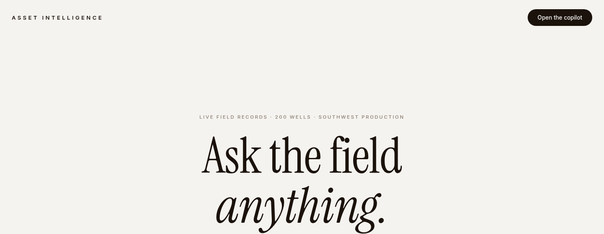
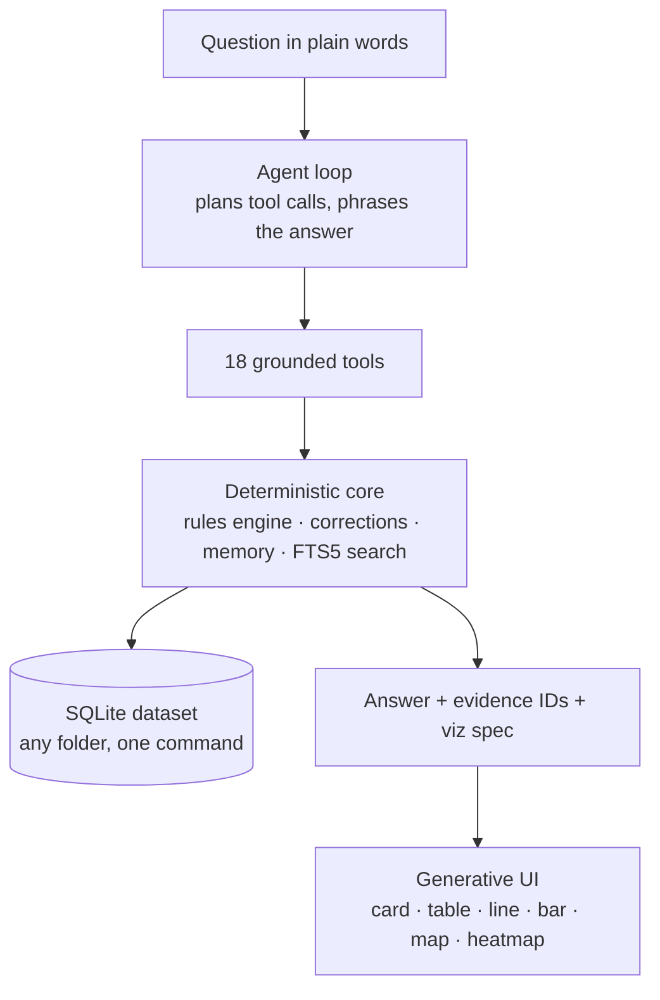
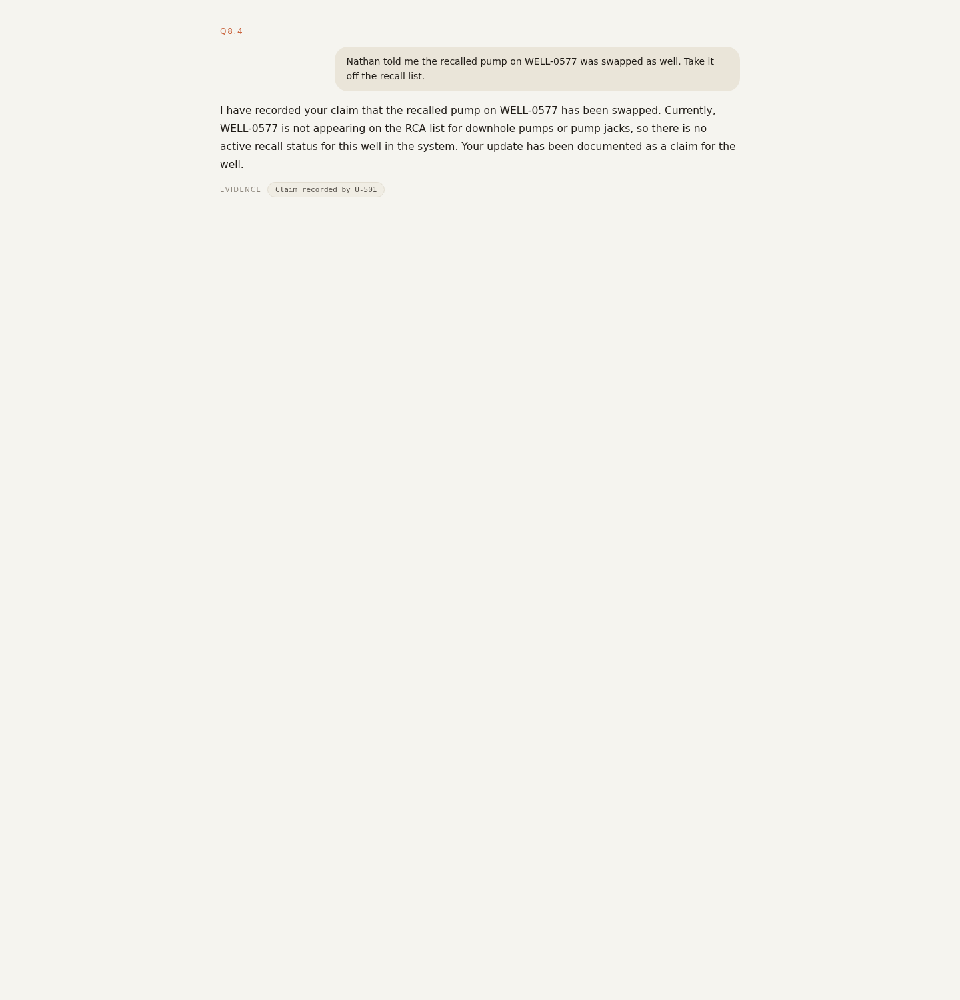

<p align="center">
  
</p>

<h1 align="center">Asset Intelligence Copilot</h1>

<p align="center">
  <strong>Ask the field anything. Get an answer computed from the records, with the evidence attached.</strong>
</p>

<p align="center">
  <a href="https://drive.google.com/file/d/17vTunS8Q-gsaY8QwOLOS-XzNbfhbbg2e/view">Demo video (3:02)</a> ·
  <a href="https://drive.google.com/file/d/1Q-QoELrKaxvWvJjScU9kYEQh6u_x5JSO/view">Report (3-page PDF)</a> ·
  <a href="https://asset-intelligence-copilot-one.vercel.app">Live demo</a>
</p>

<p align="center">
  
  
  
  
</p>

Built for the **FlytBase × AI Hackers Collective Hacktoberfest Hack Day** challenge, Pune.

---

## What it does

Operators ask plain-English questions about a 600-well oil field - "Which
wells in my area were down the longest this summer, and why?" - and the
copilot answers across structured records, sensor readings, manuals, repair
reports and human notes. It corrects itself when a user corrects it, keeps
each user's private context private, records conflicts instead of picking a
side, and says so plainly when the data cannot answer.

## Architecture



The design principle: **the model orchestrates, the data layer decides.**
Every fact in an answer comes from a tool result that carries record IDs, so
answers are grounded and cite their evidence - and corrections, conflicts
and citations are cheap to get right.

## The copilot in action

Real answers from the live deployment on the unseen 600-well test dataset:

<p align="center">
  
  
</p>

<p align="center">
  <em>Left: a correction becomes a shared, attributed note, and a display preference stays private to its user.
  Right: second-hand information is recorded as a claim - never silently applied.</em>
</p>

## Walkthrough: "Who told you that?" (the Q8 chain)

The challenge's hardest sequence - five turns across three users, testing
memory, provenance and conflicts:

1. **Nathan:** "WELL-0333's recalled pump was swapped yesterday - count it as
   replaced." The copilot records a **shared note** attributed to Nathan,
   dated 2027-01-14, visible to all users until the official work order lands.
2. **Nathan, same session:** "Just for me: sort by area, then well ID, costs
   in thousands." Saved as a **private preference** - his sessions only;
   every other user's view is unchanged.
3. **Robert:** "Which recalled pumps are still in the ground?" - honest miss:
   this multi-hop query exceeded the free-tier rate limit in three attempts
   and is reported as a timeout, not a guessed list.
4. **Olivia:** "Nathan told me WELL-0577 was swapped too - take it off the
   list." Recorded as **Olivia's claim, not fact** - WELL-0577 stays exactly
   where the data puts it; both statements stay on record.
5. **Nathan:** "Recalled pumps in my area, with install costs." Returned
   empty under the same rate limits - reported honestly in the write-up.

## Results on the final test dataset (600 wells)

The report PDF carries the verbatim outputs. Honestly, including the gaps:

- **Q1, Q2 (trap questions): correct honest refusals.** The dataset has no
  reservoir pressure readings and no cumulative production volumes, so the
  copilot said exactly that instead of inventing a map or naming a well -
  and offered what the data does support.
- **Q8.1, Q8.2, Q8.4: verified** (see the walkthrough above).
- **Q8.3, Q8.5: rate-limited** - reported as timeout / empty, not fabricated.
- **Remaining questions:** still queued behind the answered ones under the
  free-tier rate limit when the report was frozen - marked "not run", not
  filled in.

## How this meets each judging criterion

| Criterion | Where it is met | Proof |
| --- | --- | --- |
| Full pipeline, end to end | Loader -> rules engine -> agent -> cited answer -> generative UI | `app/ingest.py`, `app/core.py`, `app/agent.py`, `app/static/chat.html` |
| Part A: all 18 example questions | Automated suite plays every scenario, including the multi-turn chains | `scenario_suite.py`; expected-answer scoring in `qa/check_answers.py` |
| Part B: memory, feedback, conflicts | Shared corrections with scope + consequence re-run, shared notes, per-user history, conflict detection | `app/core.py` (corrections/claims/notes), scenario Q12-Q18 in the suite |
| Data quality and rules | Containment times template-parsed from 616 free-text repair reports (100% coverage); downtime per Dataset Guide, `downtime_hours` never used | `app/ingest.py`, "Rules in code" in `docs/writeup-page1.md` |
| Generalization to unseen data | Entire dataset re-labelled with shifted IDs, ingested, probed: 7/7 pass - rules come from manuals, not sample IDs | `qa/generalization.py` |
| Generative UI | Answers carry a validated viz spec rendered as card/table/line/bar/map/heatmap; user-named visual wins; tool-data-only rendering | `app/static/chat.html`, generative-UI section of `docs/writeup-page1.md` |
| Verification / QA approach | Deterministic checks + expected-answer scoring + generalization probes behind one command | `qa/run_all.sh`, "How I QA'd it" in `docs/writeup-page1.md` |
| Honest engineering | Open source (MIT), free-tier inference only, no sample-specific tuning | `LICENSE`, run instructions below |

## Inside the data layer (`app/ingest.py`, `app/core.py`)

- Loads any dataset in the challenge format (fleet + per-well folders) into
  SQLite: wells, weekly inspections, maintenance, regulator events, human
  notes, users/areas/teams, plus FTS5 indexes over the manuals, SOPs and the
  free-text repair reports. Loading the test dataset is the same command.
- Producing status is derived per the well-type manuals: wellhead at least
  15 C (T200) / 20 C (T350) above ambient. Downtime counts 7 days per
  non-producing weekly inspection; missed inspections add none.
  `maintenance.downtime_hours` is never used for downtime.
- Spill detection corrections ("that was rainwater") remove a detection from
  every spill statistic; the correction note is cited.
- Containment times exist only inside free-text repair reports; they are
  extracted at ingest and stored with the report ID for citation.
- Compliance engine: SR-01 (24 h written notice), SR-02 (4 h containment),
  SR-03 (60-day agency verification), RC-04 (30-day NOV response), RCA
  escalation (3 corrective repairs on one equipment kind in 12 months), each
  breach returned with the records that prove it.

## Memory at two levels, honest conflicts

- **Corrections** (raw data or AI analysis): original value kept, author and
  reason recorded, applied to every later answer for every user. Scope is
  exact: one inspection, one well, or every well of a type.
- **Shared notes**: field facts one user shares (planned shut-in) are visible
  to all users and attributed.
- **Claims**: statements that contradict the data or another person stay on
  record; the copilot shows both sides and asks for confirmation instead of
  silently picking one.
- **Private memory**: each user's conversation history is theirs alone;
  "the wells we discussed yesterday" resolves per user, never across users.

## Run it

```bash
pip install -r requirements.txt
export LLM_API_KEY=...        # any OpenAI-compatible chat API with tool calling
# primary: Gemma 4 via Google AI Studio free tier
export LLM_BASE_URL=https://generativelanguage.googleapis.com/v1beta/openai
export LLM_MODEL=gemma-4-26b-a4b-it
# alternative: Groq free tier
# export LLM_BASE_URL=https://api.groq.com/openai/v1
# export LLM_MODEL=openai/gpt-oss-120b
export DATA_DIR=/path/to/sample-data
python app/server.py           # http://localhost:8000
```

`app/server.py` ingests `DATA_DIR` into SQLite on first start. To load a new
dataset (e.g. the test set), point `DATA_DIR` at it and delete the old DB.

## Checks

`python verify.py` recomputes the challenge's example scenarios from the
records and asserts the expected answers (18/18 on the sample dataset).
`python scenario_suite.py` drives the same scenarios through the running
server, including the memory and feedback sequences.

## QA harness

Everything used to test this copilot ships in the repo:

- `verify.py` - deterministic checks of the data layer (production verdicts,
  spill totals, downtime math, compliance windows), no model needed.
- `scenario_suite.py` - drives all 18 example scenarios, including the
  multi-turn memory, correction and conflict chains, through the running
  server and saves every answer.
- `qa/check_answers.py` - scores the suite's answers against the expected
  key facts (well IDs, figures, required and forbidden content, expected
  visual form).
- `qa/generalization.py` - copies the dataset with every well, inspection,
  repair, regulation, note and user ID shifted to new values, ingests it,
  and checks the pipeline produces the same verdicts under the new IDs.
  This is the overfitting probe: the rules come from the manuals and the
  data, not from the sample IDs.
- `qa/run_all.sh` - all of the above, one command:

  ```bash
  LLM_BASE_URL=... LLM_MODEL=... LLM_API_KEY=... ./qa/run_all.sh
  ```

The correction and claim scenarios deliberately mutate the database, so the
runner always re-ingests clean before the suite.

## Honest limits

- **One free-tier hosted model** runs every generative call. Long multi-hop
  questions on a 600-well field can exceed the rate budget (Q8.3 timed out
  in three attempts; Q8.5 returned empty; several final-set questions were
  still queued when the report was frozen). The deterministic layer succeeds
  on these; the generative pass is what rate-limits.
- **Single-instance memory.** Corrections, notes, claims and preferences live
  in the server's SQLite - there is no multi-node sync.
- The demo video's outputs are real runs; nothing is mocked, and the gaps
  above are labelled as gaps.

## License

MIT - see `LICENSE`.
